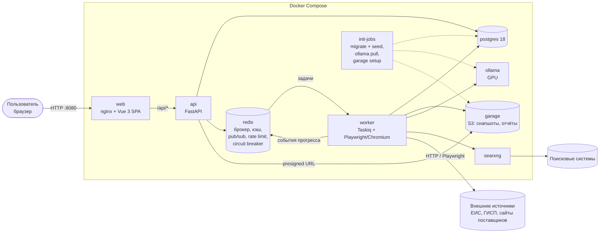
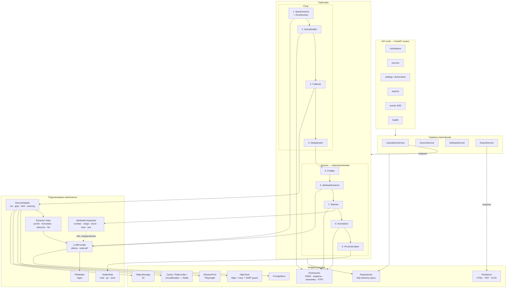
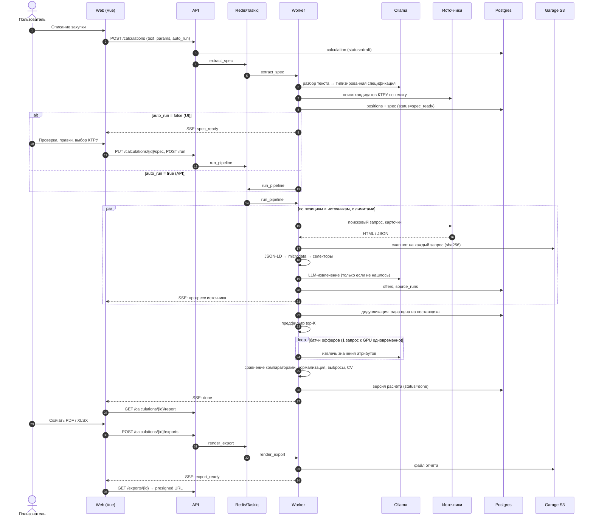
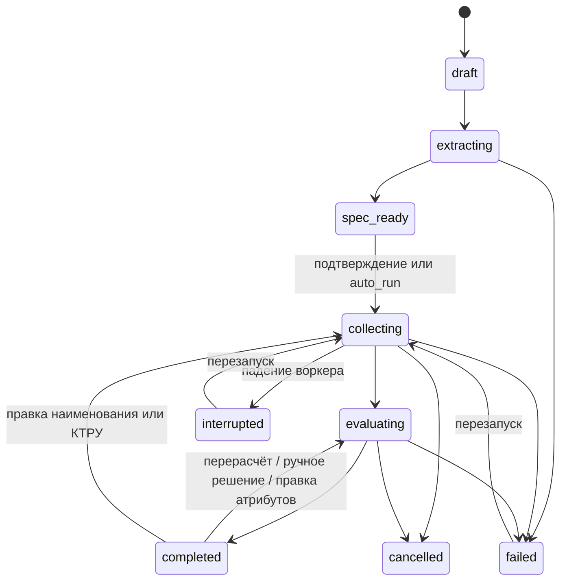
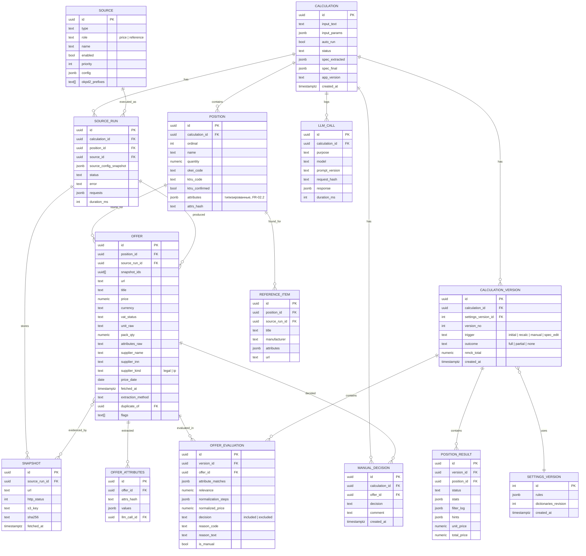
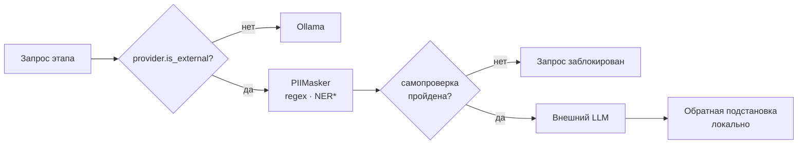

# Tender Lens — Архитектура

Версия: 0.2 · Дата: 2026-11-14

Связанные документы: [требования](01-requirements.md), [сценарии](02-use-cases.md), [план реализации](04-implementation-plan.md).

## 1. Принципы

1. **Пайплайн из независимых этапов.** Каждый этап получает и возвращает типизированные данные (Pydantic) и сохраняет результат в БД. Этапы оценки можно перезапускать без нового сбора (UC-08).
2. **LLM — только для понимания текста:** разбор описания закупки, извлечение значений атрибутов из оффера, извлечение со страниц без структурированных данных, неоднозначные текстовые атрибуты. Сравнение, нормализация, выбросы и расчёт — детерминированный код.
3. **Сначала дёшево, потом дорого.** Структурированные данные (JSON-LD, microdata) раньше селекторов, селекторы раньше LLM; текстовый предфильтр раньше LLM-извлечения атрибутов.
4. **Всё расширяемое — за интерфейсами и в реестре:** адаптеры источников, методы извлечения, компараторы атрибутов, LLM-провайдеры, правила выбросов. Конфигурация и справочники лежат в БД и меняются из UI.
5. **Сохраняется всё, что нужно для проверки:** снапшоты ответов источников, ответы LLM, версии настроек, каждый шаг преобразования цены. Воспроизводимость обеспечивается сохранёнными данными, а не повторными вызовами.
6. **Отказ одного источника не валит расчёт.** Ошибки — это данные, а не исключения, которые прерывают пайплайн.

## 2. Развёртывание (контейнеры)



| Контейнер | Образ / основа | Назначение | Порт (хост) |
|---|---|---|---|
| `web` | nginx + сборка Vue | Раздаёт SPA, проксирует `/api` на `api` | 8080 |
| `api` | python:3.14-slim | REST API, SSE-прогресс, постановка задач | 8000 в dev |
| `worker` | python:3.14 + Playwright Chromium | Пайплайн, генерация PDF/XLSX | — |
| `postgres` | postgres:18 | Основная БД | 5432 в dev |
| `redis` | redis / valkey | Брокер Taskiq, кэш ответов источников, pub/sub, rate limit, circuit breaker | — |
| `garage` | dxflrs/garage | S3-хранилище | 3900 в dev |
| `ollama` | ollama/ollama | Локальная LLM на GPU | 11434 в dev |
| `searxng` | searxng/searxng | Метапоиск | — |
| `init-jobs` | одноразовые контейнеры | Миграции Alembic и загрузка справочников; `ollama pull`; ключ и бакеты Garage. Все скрипты идемпотентны. | — |

- `api` и `worker` собираются из одного Dockerfile с разными targets. Chromium есть только в образе worker, поэтому PDF генерирует worker (`page.pdf()` из HTML-шаблона отчёта). Отдельная PDF-библиотека не нужна.
- **GPU.** У сервиса `ollama` задано `deploy.resources.reservations.devices` (driver: nvidia). На Windows нужен Docker Desktop с WSL2 и драйвер NVIDIA с поддержкой WSL. Без GPU — оверрайд `docker-compose.cpu.yml` (NFR-06.5).
- **Готовность.** У каждого сервиса есть healthcheck в Compose; `api` стартует после готовности БД и Redis. `GET /api/health` показывает состояние всех зависимостей, включая наличие модели в Ollama (NFR-06.7).

## 3. Компоненты backend



`*` — внешний провайдер в MVP не реализуется, но интерфейс и `PIIMasker` в цепочке вызова уже есть.

### 3.1. Ключевые интерфейсы

```python
class SourceAdapter(Protocol):
    type: ClassVar[str]                       # "eis", "gisp", "html", "searxng"
    config_schema: ClassVar[type[BaseModel]]  # схема настроек → форма в UI

    async def search(self, query: SourceQuery, ctx: AdapterContext) -> AdapterResult: ...
    async def healthcheck(self, ctx: AdapterContext) -> HealthStatus: ...

class AdapterResult(BaseModel):
    status: Literal["ok", "empty", "error", "timeout", "structure_changed", "skipped"]
    offers: list[RawOffer]                    # у каждого — snapshot_ids и extraction_method
    reference_items: list[ReferenceItem]      # для справочных источников (ГИСП)
    requests: list[RequestLog]                # URL, код ответа, время, snapshot_id
    error: str | None

class Extractor(Protocol):
    name: ClassVar[str]                       # "jsonld", "microdata", "selectors", "llm"
    async def extract(self, page: FetchedPage, cfg: ExtractConfig) -> list[RawOffer]: ...

class AttributeComparator(Protocol):
    type: ClassVar[str]                       # "number", "range", "enum", "bool", "text"
    def compare(self, required: SpecAttribute, actual: ExtractedValue | None,
                ctx: CompareContext) -> AttributeMatch: ...   # match / mismatch / unknown + пояснение

class LLMProvider(Protocol):
    name: str
    is_external: bool                         # True → обязательный PIIMasker
    async def complete_json(self, prompt: Prompt, schema: type[T]) -> LLMResult[T]: ...

class OutlierRule(Protocol):
    name: str
    def apply(self, prices: list[Decimal], params: dict) -> OutlierDecision: ...
```

- **Реестры.** Компоненты регистрируются декоратором (`@register_adapter`, `@register_comparator` и т. д.). UI берёт список типов адаптеров и JSON Schema их настроек из `GET /api/source-types` и строит форму. Новый тип — это новый класс; ядро пайплайна не меняется (FR-03.8).
- **Ошибки как результат.** Адаптер не бросает исключения наружу: обёртка `AdapterRunner` применяет таймаут, ретраи, rate limit и circuit breaker и возвращает `AdapterResult` с нужным статусом.
- **`CompareContext`** содержит справочники ОКЕИ (для пересчёта единиц в `number`/`range`) и синонимов (для `enum`/`bool`/`text`).

## 4. Пайплайн расчёта

### 4.1. Поток данных



### 4.2. Этапы

| # | Этап | Вход → выход | LLM | Ключевая логика |
|---|---|---|---|---|
| 1 | **SpecExtractor + KtruResolver** | текст → `list[PositionSpec]` | да | Структурированный вывод по JSON Schema с типизированными атрибутами (FR-02.2), до 3 повторов. Единица → ОКЕИ по справочнику. Модель выдаёт поисковую фразу для КТРУ, код подбирается поиском по справочнику (FR-02.4). |
| 2 | **QueryBuilder** | `PositionSpec` × `Source` → `SourceQuery` | нет | Шаблоны запросов: наименование + 2–3 ключевых атрибута (с синонимами); для ЕИС — код КТРУ/ОКПД2 и период. Источники фильтруются по категориям ОКПД2. |
| 3 | **Collector** | `SourceQuery` → `RawOffer[]`, `ReferenceItem[]` | только fallback | Параллельно с семафором на источник; rate limit, таймаут, ретраи (tenacity), circuit breaker; кэш по хешу запроса с исходным `fetched_at`; снапшот на каждый запрос. Извлечение — цепочка FR-04.9; перед LLM страница сжимается до ≤ 2k токенов вокруг цены (FR-04.10). Ограничение — не больше `max_offers` на источник и позицию. |
| 4 | **Deduplicator** | `RawOffer[]` → `Offer[]` | нет | Канонизация URL; номер контракта + позиции для ЕИС; rapidfuzz по «наименование + поставщик» при равной цене; одна цена на поставщика (FR-05.5). |
| 5 | **Prefilter** | `Offer[]` → top-K | нет | rapidfuzz/BM25 по наименованию и ключевым числам (с синонимами). Ниже top-K — `low_text_similarity`. Сразу отсекаются `currency_unsupported`, `stale_price`, `missing_price`. |
| 6 | **AttributeExtractor** | top-K офферов × атрибуты спецификации → `ExtractedValue` | да | Батчи по 3–5 офферов в одном вызове, схема-массив. Кэш по ключу `(offer_id, attrs_hash, model, prompt_version)` — при перерасчёте повторно не вызывается. Для офферов с готовыми атрибутами (JSON-LD `additionalProperty`, ЕИС) LLM не нужна. |
| 7 | **Matcher** | `ExtractedValue` × `SpecAttribute` → `AttributeMatch[]`, релевантность | только `text` | Компараторы по типам (FR-06.4), синонимы и пересчёт единиц из справочников. `mismatch` обязательного → `required_attr_mismatch`; скоринг по весам; порог → `low_relevance`; регион → `region_mismatch`. Ручные решения применяются здесь поверх автоматических. |
| 8 | **Normalizer** | `Offer` → `NormalizedPrice` + шаги | нет | ОКЕИ-пересчёт, фасовка, НДС по `vat_status`, индекс цен по дате. Каждый шаг: `{op, factor, before, after, reason}`. Несводимая единица → `unit_incompatible`. |
| 9 | **PriceCalculator** | `NormalizedPrice[]` → `PositionResult` | нет | n < 5 → без фильтра выбросов (флаг); иначе MAD/IQR → CV → статус `ok` / `heterogeneous` / `insufficient_data`; опциональная подрезка (≤ 20 %) → `ok_adjusted`. Детектор кластеров для подсказки. `Decimal`, half-up до копеек. Протокол всех шагов. |

Этапы 1–4 выполняются при сборе. Этапы 5–9 — при оценке; каждый запуск оценки создаёт новую `calculation_version` со ссылкой на `settings_version`.

### 4.3. Статусы

**Расчёт:**



`completed` — пайплайн завершился. Результат описывается полями версии: `outcome` = `full` (цены по всем позициям), `partial` (по части) или `none` (ни по одной). Поэтому перерасчёт доступен из любого результата, включая «недостаточно данных».

**Позиция (в версии):** `ok`, `ok_adjusted`, `heterogeneous`, `insufficient_data` (FR-08.9).

### 4.4. Прогресс

Worker публикует события `{calculation_id, stage, position_id, source_id, status, counts}` в Redis pub/sub. API отдаёт их в `GET /api/calculations/{id}/events` (SSE). Текущий статус дублируется в БД, поэтому после перезагрузки страницы UI восстанавливает состояние обычным GET.

## 5. Модель данных



- **Снапшоты** привязаны к HTTP-запросу. Оффер ссылается на один или несколько снапшотов (`snapshot_ids`): страницу выдачи и карточку товара или контракта.
- **Ручные решения** привязаны к паре «расчёт + оффер» и применяются в каждой новой версии (FR-06.9).
- **Атрибуты оффера** хранятся вне версии и переиспользуются при перерасчёте, пока не изменился набор атрибутов позиции (`attrs_hash`).
- **Справочники:** `unit` (ОКЕИ с коэффициентами и написаниями), `price_index` (ИПЦ месяца к предыдущему), `synonym_group`; `ktru_item` — не реализован (этап 3, нужен доступ к ЕИС). Справочники пока не версионируются: перерасчёт берёт их текущее состояние, а шаги нормализации каждого оффера (коэффициенты единиц, НДС, индекс) сохраняются в версии расчёта.
- **Поправки цены после пересчёта единиц** (FR-07.3, FR-07.5): цена без НДС × (1 + ставка); цена месяца M × произведение ИПЦ месяцев после M до последнего месяца таблицы. Каждая поправка — отдельный шаг (`vat`, `index`) с коэффициентом. Нормализованная цена хранится и участвует в расчёте с точностью 4 знака — XLSX по тем же числам даёт ту же цену.
- **Circuit breaker** (NFR-02.3): счётчик ошибок подряд по источнику в Redis; после `breaker_threshold` ошибок (`error`, `timeout`, `structure_changed`) источник пропускается `breaker_cooldown_s` секунд со статусом `circuit_open`; успешный ответ сбрасывает счётчик.
- **Коды причин** — перечень из [требований, §4.13](01-requirements.md#413-справочник-причин-исключения).

## 6. Источники в MVP

| Тип | Роль | Способ доступа | Особенности |
|---|---|---|---|
| `eis` | price | HTML-поиск по реестру контрактов ЕПЗ (zakupki.gov.ru): несколько страниц выдачи (по 50), отбор контрактов по сходству объекта закупки до загрузки карточек; карточка «Объекты закупки» + «Характеристики ТРУ» + «Общая информация» + «Исполнение». Поиск сначала по поисковой фразе (с маркой/моделью), при пустой выдаче — по наименованию. | Фильтр «исполнение завершено» и период. Из карточки берётся цена за единицу позиции, наиболее похожей на позицию закупки. ЕПЗ доступна только с российских IP; сертификат выдан НУЦ Минцифры — его корневой сертификат (`app/sources/certs`) доверяется только для доменов из `RU_TRUSTED_CA_HOSTS` (по умолчанию `gov.ru`). Без заголовка User-Agent ЕПЗ отвечает 404. |
| `html` | price | Шаблон URL + цепочка извлечения | Создаётся из UI (UC-09). Опция `render_js` использует Playwright. SSRF-guard. |
| `searxng` | price | JSON API SearXNG → URL карточек товаров → загрузка карточек → цепочка извлечения | Основной путь к ценам магазинов: страницы поиска большинства магазинов закрыты `robots.txt` (Комус, Офисмаг, ОнлайнТрейд, Регард, Релеф, Минимакс, НИКС), а карточки открыты для индексации. Отсекаются страницы категорий, тегов и поиска; маркетплейсы с защитой от ботов — в denylist; по одной карточке с домена; поставщик — домен. |
| `gisp` | reference | Каталог продукции ГИСП (gisp.gov.ru) | Отечественные аналоги, производитель, характеристики → `REFERENCE_ITEM`. Могут дополнять поисковые запросы для ценовых источников. |

**Устойчивость** (NFR-02):
- таймаут на запрос 20 с, на источник в рамках позиции — 90 с;
- ретраи: 3 попытки, экспоненциальная задержка с jitter, только на сетевые ошибки, 5xx и 429;
- circuit breaker в Redis: 5 ошибок подряд → источник пропускается 10 минут;
- `structure_changed` — HTTP 200, непустое тело, ни один метод извлечения не нашёл офферов.

## 7. LLM

- **Провайдер:** Ollama, `/api/chat` с `format: <JSON Schema>`, `temperature: 0`, фиксированный `seed`, `num_ctx: 8192`.
- **Задачи и бюджет контекста:**

| Задача | Вход | Частота |
|---|---|---|
| Разбор закупки | текст закупки (до ~5k токенов) | 1 на расчёт |
| Извлечение атрибутов | 3–5 офферов × ~300 токенов + список атрибутов | ~3–5 вызовов на позицию (top-K = 15) |
| Извлечение со страницы | сжатый фрагмент ≤ 2k токенов | только если JSON-LD, microdata и селекторы не сработали |
| Сравнение `text`-атрибутов | пара значений | только при неоднозначном нечётком сравнении |

- **Модель:** задаётся `OLLAMA_MODEL`, по умолчанию `qwen3:4b` (вызовы с `think: false`). Замер на этапе 0 (GTX 1660 Super, доступно ~5 ГБ VRAM, контекст 8k, KV-кэш q8_0, разбор одной позиции):

| Модель | Время вызова | Генерация | Размещение | Качество разбора |
|---|---|---|---|---|
| qwen2.5:7b | 15,2 с | 12,9 ток/с | 3,9 из 4,8 ГБ в GPU, остальное на CPU | лучшее; артефакты в числовых значениях |
| **qwen3:4b** | 3,7 с | 54,6 ток/с | целиком в GPU | хорошее; ошибка в числовом значении |
| qwen2.5:3b | 2,7 с | 69,6 ток/с | целиком в GPU | неприемлемое: выдумывает значения |

  Ошибки в числах лечатся схемой с отдельными числовыми полями (`value_number`, `value_min`, `value_max`) вместо строкового `value`. Окончательный выбор — по эталонному набору на этапе 1 (NFR-05.6); `qwen2.5:7b` остаётся вариантом, если точность важнее скорости.
- **Очередь к GPU:** семафор `LLM_MAX_CONCURRENCY=1` в worker. Сетевой сбор идёт параллельно.
- **Промпты:** `backend/app/llm/prompts/*.jinja`, версия в заголовке шаблона, сохраняется в `LLM_CALL`.
- **Воспроизводимость:** ответы сохраняются в `LLM_CALL` и `OFFER_ATTRIBUTES`; перерасчёт берёт их из БД.
- **Защита ПДн:** при `is_external = True` провайдер оборачивается в `PIIGuard`. В MVP `PIIMasker` — регулярные выражения (FR-11.2); NER добавляется вместе с внешним провайдером.



## 8. API (основные ресурсы)

| Метод и путь | Назначение |
|---|---|
| `POST /api/calculations` | Создать расчёт: `text`, `params`, `auto_run` (по умолчанию `true`) |
| `GET /api/calculations` | История (поиск, пагинация) |
| `GET /api/calculations/{id}` | Состояние, спецификация, версии |
| `PUT /api/calculations/{id}/spec` | Сохранить спецификацию: до запуска; после расчёта — перерасчёт (правка характеристик, количества) или сбор только новых и изменённых позиций (UC-05) |
| `POST /api/calculations/{id}/run` | Запустить сбор и расчёт |
| `POST /api/calculations/{id}/recalculate` | Новая версия на тех же данных |
| `POST /api/calculations/{id}/cancel` | Отмена |
| `GET /api/calculations/{id}/events` | SSE-прогресс; новый запуск очищает историю событий |
| `GET /api/calculations/{id}/report?version=` | Отчёт в JSON |
| `GET /api/calculations/{id}/audit?version=` | Полный след: отчёт, запросы к источникам, вызовы LLM (FR-09.5) |
| `GET /api/calculations/{id}/versions` | Итоги всех версий по позициям — сравнение версий (UC-08) |
| `PUT/DELETE /api/calculations/{id}/offers/{offer_id}/decision` | Ручное решение по офферу с обязательным комментарием / его отмена → новая версия (FR-06.9) |
| `GET /api/calculations/{id}/export?format=xlsx\|pdf\|html&version=` | Выгрузка отчёта. XLSX и HTML формирует API; PDF — задача воркера `export.pdf` (Chromium), файл сохраняется в бакете `reports` и отдаётся через API |
| `GET /api/snapshots/{id}` | Снапшот страницы (через API, с CSP sandbox) |
| `GET /api/source-types` | Типы адаптеров и JSON Schema их настроек |
| `GET/POST/PUT/DELETE /api/sources`, `PATCH /api/sources/{id}/enabled` | CRUD источников |
| `POST /api/sources/probe`, `POST /api/sources/{id}/probe` | Тестовый запрос к источнику (черновик или сохранённый) |
| `GET /api/sources/health`, `POST /api/sources/{id}/breaker/reset` | Состояние источников: последний успех, доля ошибок, circuit breaker (FR-03.6) |
| `GET/PUT /api/settings`, `GET /api/settings/versions` | Правила расчёта и JSON Schema формы; PUT создаёт новую версию, если правила изменились |
| `GET /api/units`, `PUT/DELETE /api/units/{code}` | Справочник единиц ОКЕИ и коэффициентов |
| `GET/POST /api/synonyms`, `PUT/DELETE /api/synonyms/{id}` | Справочник синонимов |
| `GET/PUT /api/price-indexes` | Таблица ИПЦ по месяцам (PUT заменяет целиком) |
| `GET /api/health` | Готовность сервисов (БД, Redis, S3, Ollama + модель, SearXNG) |

## 9. Frontend

Vue 3 (Composition API, `<script setup>`), TypeScript, Vite, Vue Router, Pinia. UI-компоненты — Vuetify 4 (Material Design, иконки MDI, русская локализация). Контракт API — `contracts/openapi.json`: выгружается из FastAPI, из него генерируются типы клиента (`openapi-typescript` + `openapi-fetch`), а системные тесты сверяют его с работающим API.

| Раздел | Содержание |
|---|---|
| Новый расчёт | Ввод текста и параметров, переключатель «проверить спецификацию перед поиском» → редактор спецификации (типы атрибутов, операторы, выбор КТРУ) → запуск |
| Расчёт | Прогресс (этапы × источники), затем отчёт: итог и признак неполноты, позиции со статусами, включённые и исключённые предложения, статус сравнения по каждому атрибуту, распределение цен и подсказки по кластерам, справочный блок ГИСП, ручные решения, версии, выгрузка |
| История | Список расчётов, поиск |
| Источники | Список со статусами, форма по JSON Schema типа, кнопка «Проверить» с показом метода извлечения |
| Настройки | Правила; справочники ОКЕИ, индексов цен, синонимов |

## 10. Структура репозитория

```
tender-lens/
├─ backend/
│  ├─ app/
│  │  ├─ api/            # routers, схемы запросов и ответов
│  │  ├─ core/           # конфиг (pydantic-settings), логирование, DI
│  │  ├─ db/             # модели SQLAlchemy, репозитории
│  │  ├─ pipeline/       # этапы 1–9, оркестратор
│  │  ├─ sources/        # интерфейс, реестр, адаптеры eis/gisp/html/searxng
│  │  ├─ extraction/     # jsonld, microdata, selectors, llm; очистка и сжатие страниц
│  │  ├─ matching/       # предфильтр, компараторы, скоринг
│  │  ├─ calc/           # нормализация, выбросы, статистика, кластеры (чистый Python)
│  │  ├─ llm/            # провайдеры, PII, prompts/
│  │  ├─ reports/        # шаблоны HTML, рендер PDF (Playwright), XLSX
│  │  ├─ storage/        # S3, кэш, rate limit, circuit breaker
│  │  └─ worker.py       # Taskiq broker и задачи
│  ├─ migrations/        # Alembic
│  ├─ seed/              # ОКЕИ, индексы цен, синонимы, источники по умолчанию
│  ├─ tests/             # unit, HTML-фикстуры источников, golden/ — эталонный набор
│  ├─ pyproject.toml     # uv
│  └─ Dockerfile         # targets: api, worker
├─ frontend/
│  ├─ src/{pages,components,stores,api}
│  ├─ package.json
│  └─ Dockerfile         # build → nginx
├─ infra/
│  ├─ garage/garage.toml
│  ├─ searxng/settings.yml
│  ├─ nginx/default.conf
│  └─ init/              # идемпотентные скрипты init-jobs
├─ contracts/
│  └─ openapi.json       # контракт API: источник типов фронтенда и эталон для системных тестов
├─ tests/
│  └─ system/            # системные тесты: вся система как чёрный ящик по HTTP
├─ docs/
├─ docker-compose.yml
├─ docker-compose.cpu.yml
├─ .env.example
└─ README.md
```

## 11. Ключевые решения

| Решение | Альтернативы | Почему |
|---|---|---|
| Типизированные атрибуты + компараторы кодом | LLM ставит оценку сопоставимости | Детерминизм и объяснимость; мелкая модель надёжнее в узкой задаче извлечения значения. |
| Предфильтр top-K и батчинг | LLM по всем офферам | Время расчёта на 6 ГБ VRAM: LLM-вызовы последовательны. |
| JSON-LD → microdata → селекторы → LLM | Только селекторы или только LLM | Большинство магазинов публикуют `schema.org/Offer`; LLM — запасной путь. |
| MAD по умолчанию, без автоподрезки | IQR + итеративная подрезка до CV ≤ 33 % | Устойчивость на малых выборках; подрезка выглядит как подгонка, поэтому она опциональна и ограничена. |
| Коды КТРУ через справочник | Генерация кода LLM | Выдуманный код ломает поиск в ЕИС. |
| ГИСП как справочный источник | ГИСП как ценовой | Цен в ГИСП почти нет; иначе он засоряет исключённые. |
| Taskiq + Redis | Celery, arq, BackgroundTasks | Нативный asyncio, лёгкий; arq в режиме поддержки; BackgroundTasks не переживают рестарт. |
| SSE для прогресса | WebSocket, polling | Поток в одну сторону, без лишних зависимостей. |
| PDF через Playwright в worker | WeasyPrint | Chromium уже есть в worker; минус системные зависимости и риск с Python 3.14. |
| Garage | MinIO, файловая система | S3-совместимый, активно развивается; S3 API позволяет сменить хранилище. |
| Источники и справочники в БД | YAML-файлы | Управление из UI без перезапуска; экспорт в YAML как дополнение. |
| `Decimal` для денег | float | Точность до копеек, совпадение с XLSX. |

## 12. Риски

| Риск | Митигация |
|---|---|
| ЕПЗ блокирует частые запросы или меняет вёрстку | Rate limit, кэш, селекторы в конфиге, фикстурные тесты, статус `structure_changed`; демо-данные в кэше на защиту. |
| Мелкая LLM ошибается в разборе и извлечении | Типизированная схема, редактор спецификации, компараторы кодом, эталонный набор для выбора модели и промптов. |
| Модель не помещается в 6 ГБ с нужным контекстом | Модель 3–4B, сжатие страниц, батчи небольшого размера. |
| Расчёт дольше целевого времени | Top-K, батчинг, кэш атрибутов, извлечение без LLM; цель NFR-01.1 уточняется замером. |
| SearXNG блокируется поисковиками | Allowlist доменов, роль запасного источника, кэш. |
| Мало цен в ЕИС для узких товаров | Статусы `insufficient_data` / `heterogeneous` с рекомендациями вместо необоснованной цены. |
| Совместимость библиотек с Python 3.14 | Проверка на этапе 0 (Playwright, asyncpg, extruct, rapidfuzz, openpyxl); при проблеме — замена конкретной зависимости. |
| 9 контейнеров — сложный старт в чистом окружении | Healthchecks, идемпотентные init-скрипты, `/api/health`, раздел «если не запускается» в README. |
